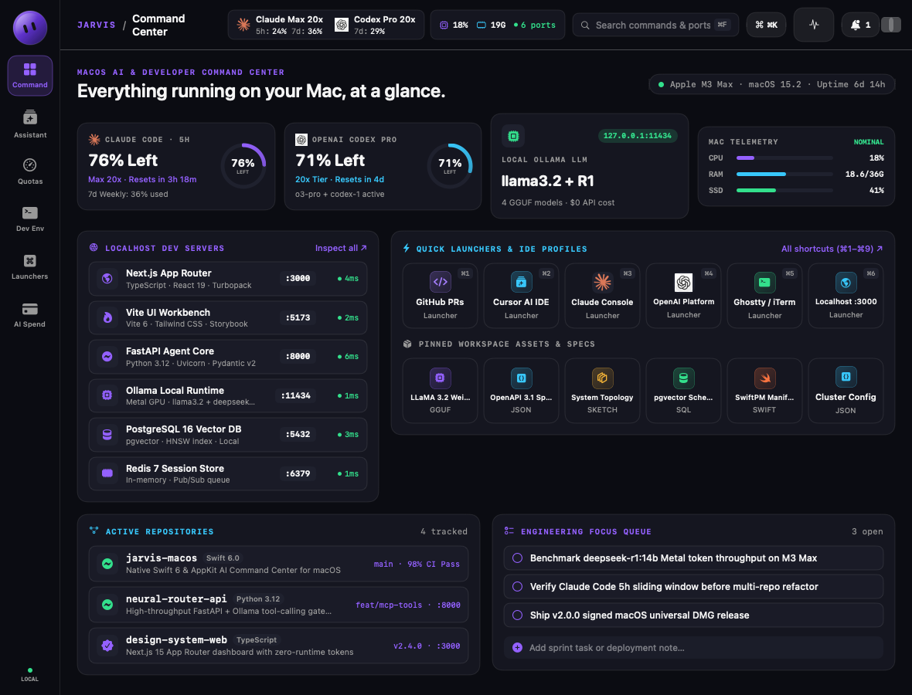
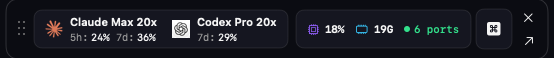
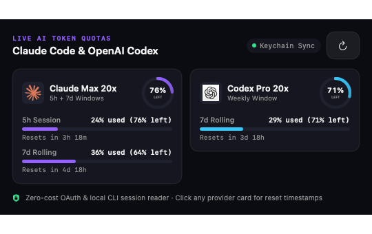
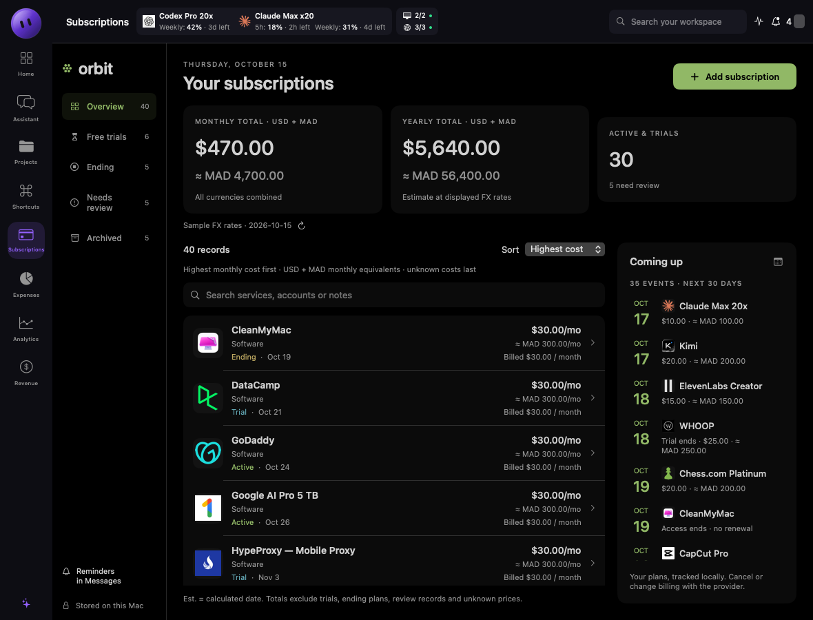
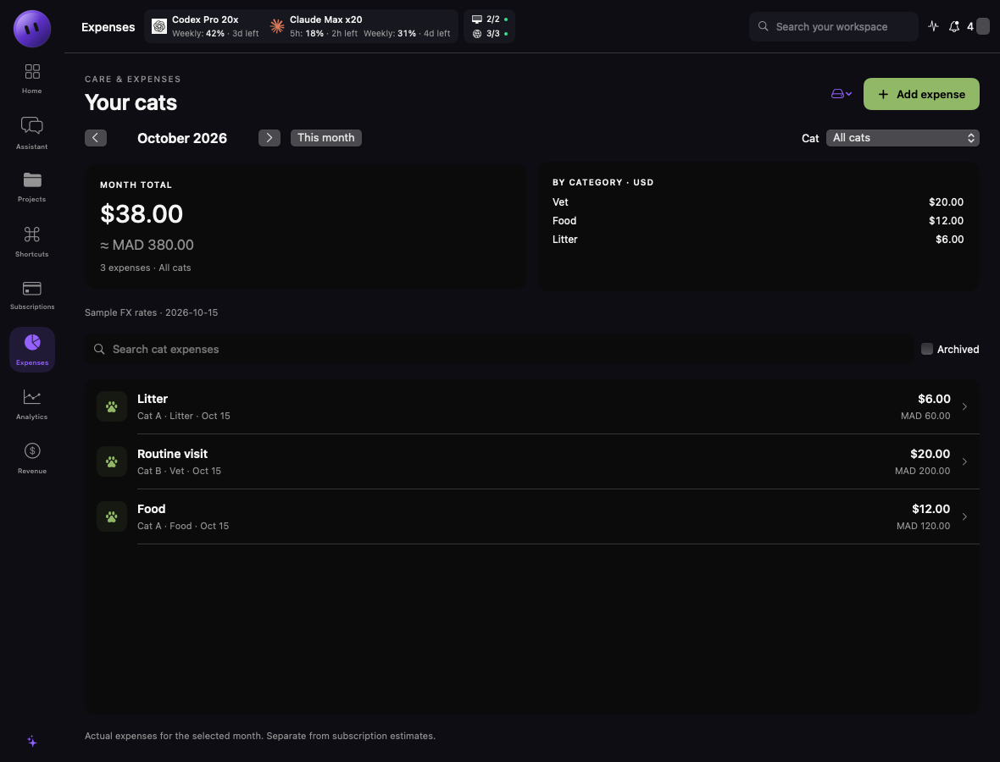
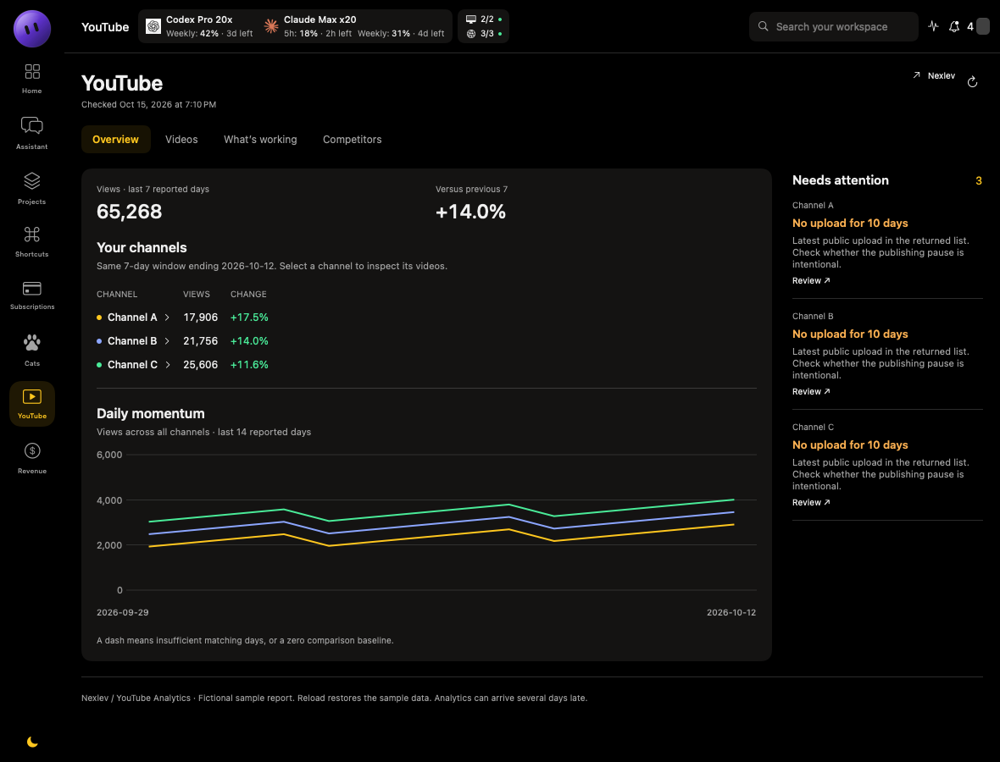
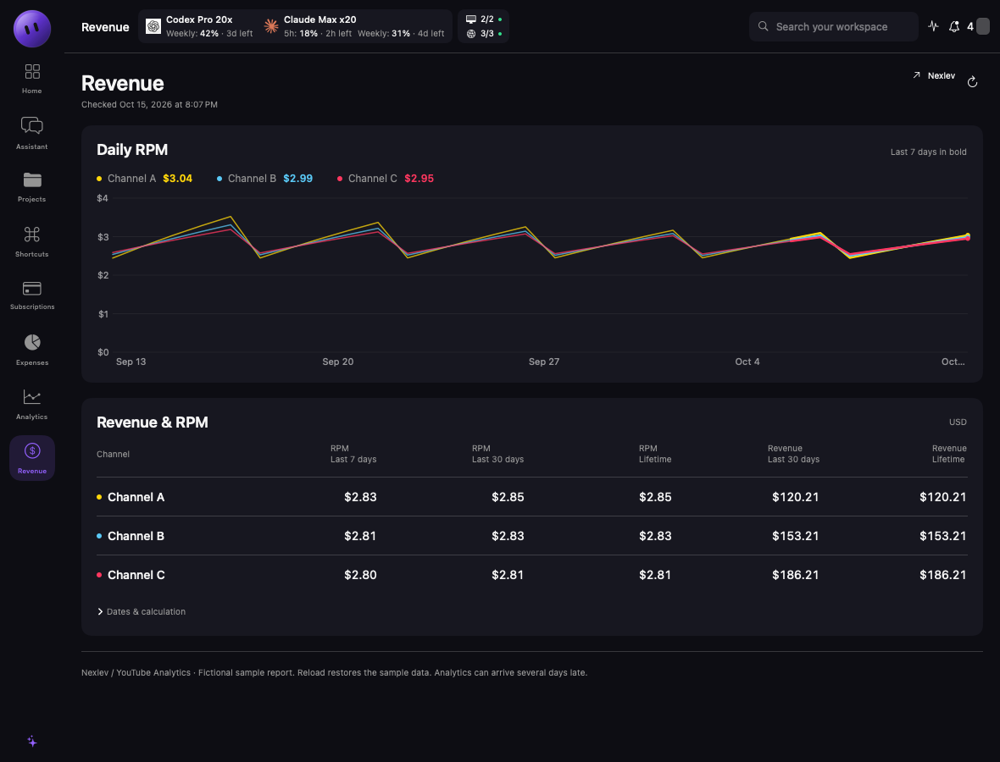
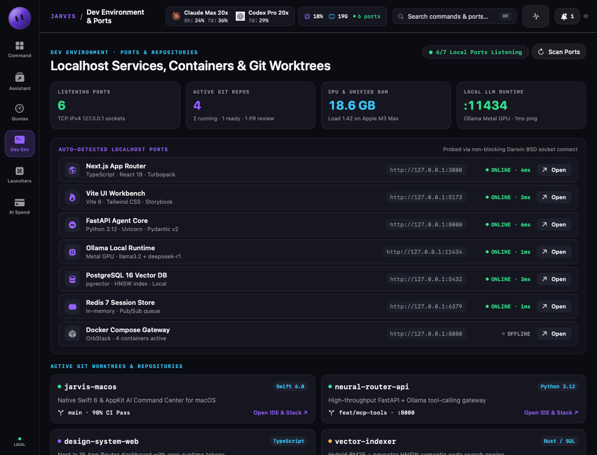
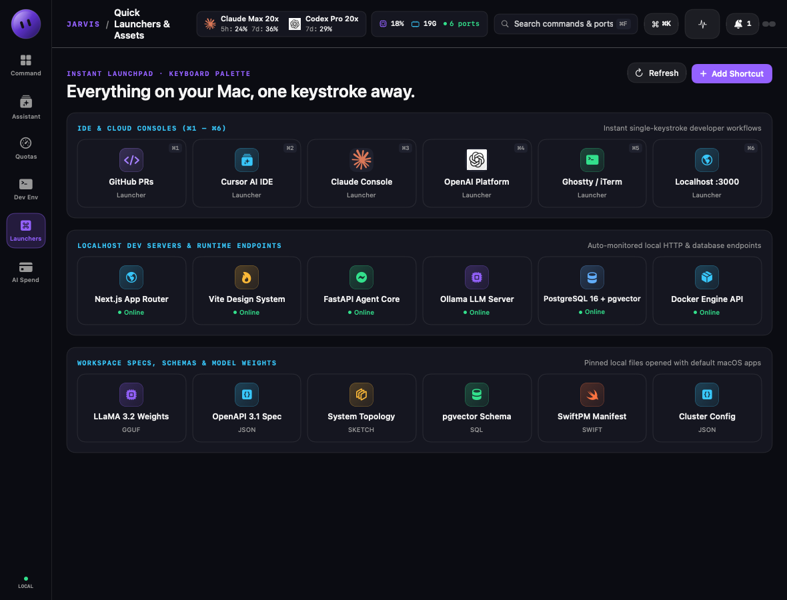
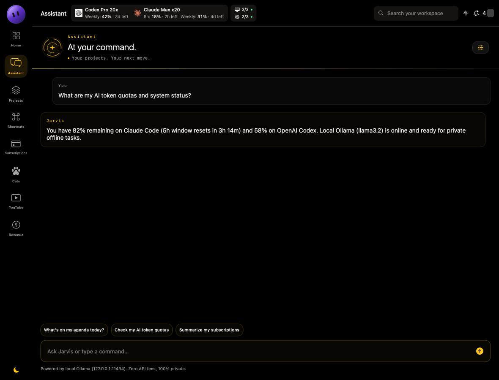

# Jarvis for macOS

[](LICENSE)
[](https://www.apple.com/macos/)
[](https://swift.org)
[](https://github.com/aliradid/jarvis-macos/actions/workflows/checks.yml)

**A native, OLED-dark macOS workspace dashboard and floating widget built with SwiftUI and AppKit.**

Jarvis brings your projects, local/browser shortcuts, subscriptions tracker, pet expenses, and real-time AI quota monitoring (Claude & Codex) into a cohesive, high-performance workspace.

* 🚀 **Floating HUD Widget:** Always-accessible floating pill on macOS displaying live Claude session & weekly usage, Codex quotas, machine health, and quick-launch channels.
* 💳 **Orbit Subscriptions:** Local-first recurring cost manager with currency normalization (USD/MAD/EUR/GBP), live exchange rates via ECB, renewal alerts, and trial countdowns.
* 🐾 **Pet Expenses:** Full monthly breakdown, category filtering, search, and native JSON backup import/export.
* ⚡ **Live Launcher & Servers:** Native file/folder launching, local development server health probing (`HEAD` requests), and custom Chrome profile switches.
* 📊 **Live AI Usage Tracking:** Direct integration with Claude Code (`~/.claude/.credentials.json` & macOS Keychain) and OpenAI Codex CLI (`~/.codex/auth.json`) to track remaining tokens and sliding-window resets.
* 🔒 **Local & Private:** Zero telemetry, no cloud accounts required. All data persists safely in `~/Library/Application Support/Jarvis/`. Run with `--demo` anytime to explore with isolated sample fixtures.

## Workspace



The home dashboard features quick access shortcuts, Photoshop/design files, recent work, daily checklist, pinned actions, and items needing immediate attention.

## Floating widget



Choose **Widget → Show floating widget** from the app's menu bar. Drag the handle to reposition anywhere on screen, click quota or status indicators for deep-dive panels, or jump straight back to the main workspace.



## Subscriptions



The original Orbit interface includes monthly and yearly USD/MAD totals, billing-cycle conversion, a renewal timeline, trials, ending plans, records needing review, search, sorting and archiving. The subscription editor retains price and date certainty, reminder settings, notes and source fields. Unknown costs and missing exchange rates are disclosed rather than counted as zero.

## Expenses and analytics



Cat expenses retain the original monthly view, category totals, search, filters, editing, archiving and import/export controls.





YouTube includes the original Overview, Videos, What’s working and Competitors views. Revenue uses the original daily RPM chart and financial comparison table. Sample daily records feed the existing calculations; thumbnails use the existing empty-image presentation.

## Projects, shortcuts and assistant







Project browsing and setup previews, shortcut editing, messages, diagnostics, and the assistant interface come from the personal app. The assistant does not generate replies in this edition. External project launching and server startup report that they are disabled.

## Run

Requires macOS 13 or later and Swift 5.9 or later. No external package dependencies are required.

```sh
git clone https://github.com/aliradid/jarvis-macos.git
cd jarvis-macos

# Run Jarvis (starts your own real workspace, saved locally)
swift run JarvisDemo

# Or explore in isolated demo mode with synthetic fixtures
swift run JarvisDemo --demo
```

Your personal workspace configuration and records persist locally under `~/Library/Application Support/Jarvis/`. File import/export uses native macOS dialogs.

## Verification & Checks

```sh
python3 scripts/check_publication.py
swift build
bash scripts/test-core.sh
swift run JarvisDemo --check
```

The regression suite validates configuration recovery from corruption, duplicate ID rejection, URL safety filters, and model calculations.

See [architecture](docs/ARCHITECTURE.md), [source fidelity](docs/SOURCE_FIDELITY.md), [publication boundaries](docs/PUBLICATION.md) and [security](SECURITY.md).

## License

This project is licensed under the [MIT License](LICENSE). Brand artwork is included solely to identify compatible external services; trademarks remain the property of their respective owners.
