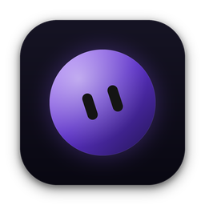
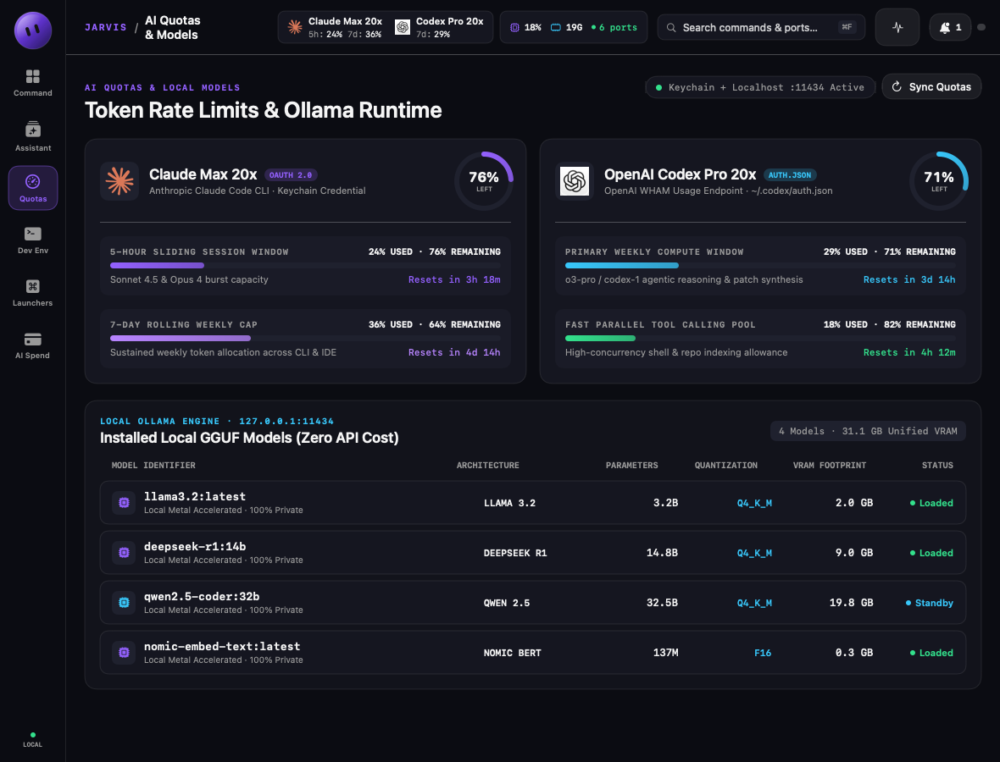
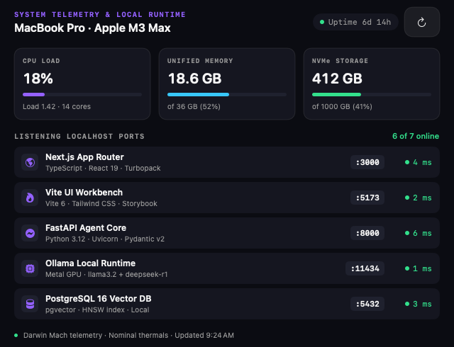

<p align="center">
  
</p>

<h1 align="center">Jarvis for macOS</h1>

<p align="center">
  <strong>The Native macOS AI & Developer Command Center — Live Claude Code & OpenAI Codex Quotas, Local Ollama Assistant, Darwin Telemetry, Localhost Port Scanner, and AI Spend Tracker.</strong>
</p>

<p align="center">
  <a href="https://github.com/aliradid/jarvis-macos/releases/latest"></a>
  <a href="https://github.com/aliradid/jarvis-macos/actions/workflows/checks.yml"></a>
  <a href="https://www.apple.com/macos/"></a>
  <a href="https://swift.org"></a>
  <a href="LICENSE"></a>
</p>

<p align="center">
  <a href="https://github.com/aliradid/jarvis-macos/releases/latest"><strong>⬇ Download Universal DMG (v2.0.0)</strong></a> •
  <a href="#quick-install-one-liner"><strong>One-Line Install</strong></a> •
  <a href="#the-5-core-pillars"><strong>5 Core Pillars</strong></a> •
  <a href="#floating-hud--menu-bar"><strong>Floating HUD</strong></a> •
  <a href="#keyboard-shortcuts"><strong>Shortcuts</strong></a>
</p>

---


## Why Jarvis for macOS?

Modern AI-native engineering spans multiple token windows, local LLM runtimes, microservices, and recurring cloud tools. **Jarvis for macOS** unifies your entire local developer stack into a zero-cost (`$0`), 100% private native SwiftUI & AppKit desktop command center:

- **Live AI Token Quotas (`Claude Code` + `OpenAI Codex`):** Reads your local macOS Keychain (`Claude Code-credentials` / `~/.claude/.credentials.json`) and Codex session (`~/.codex/auth.json`) to display real-time **5-hour sliding session** and **7-day rolling weekly** utilization with circular gauges and exact reset countdowns.
- **Private Local Ollama Assistant (`127.0.0.1:11434`):** Chat with local GGUF models (`llama3.2:latest`, `deepseek-r1:14b`, `qwen2.5-coder:32b`), switch system prompt presets, and trigger one-click workspace actions with zero API fees.
- **Real Darwin Kernel Telemetry & Port Scanner:** Native `sysctl`, `host_statistics64`, and non-blocking BSD socket probes monitor real CPU load, Unified Memory, NVMe disk usage, and listening localhost dev servers (`:3000` Next.js, `:5173` Vite, `:8000` FastAPI, `:11434` Ollama, `:5432` PostgreSQL, `:6379` Redis).
- **Always-On Floating HUD (`⌥⌘J`):** Draggable non-activating `NSPanel` pill that floats across all macOS Spaces and full-screen apps for instant quota & port visibility.
- **AI & Cloud Spend Tracker (`Orbit`):** Track recurring AI & developer subscriptions (`Claude Max`, `ChatGPT Pro`, `Cursor Pro`, `GitHub Copilot`, `AWS`, `Vercel`, `Supabase`) with live multi-currency normalization (`USD`, `EUR`, `GBP`, `MAD`) and renewal reminders.

---

## Quick Install (One-Liner)

Install the latest signed Universal `.app` directly to `/Applications` from your terminal:

```sh
curl -fsSL https://raw.githubusercontent.com/aliradid/jarvis-macos/main/scripts/install.sh | bash
```

Or download **`Jarvis.dmg`** directly from the **[Latest GitHub Release](https://github.com/aliradid/jarvis-macos/releases/latest)** and drag **Jarvis.app** to `/Applications`.

---

## The 5 Core Pillars

### 1. Command Center (`Overview`)
Your real-time mission control: circular quota rings for **Claude Code Max 20x** and **OpenAI Codex Pro 20x**, active **Ollama** runtime status, **Darwin Mach telemetry** bars (CPU, Unified RAM, NVMe SSD), listening **localhost dev servers** with ping latencies, one-click **IDE launchers** (`⌘1`–`⌘6`), **Active Git Repositories**, and your **Engineering Focus Queue**.

### 2. Local Ollama AI Assistant (`Assistant`)


- **Model Selector & Live Streaming:** Switch instantaneously between installed local models (`llama3.2:latest`, `deepseek-r1:14b`, `qwen2.5-coder:32b`) discovered via `http://127.0.0.1:11434/api/tags` with real-time token streaming.
- **Interactive Telemetry Context Toggles:** Toggle live injection of **Quotas**, **Ports**, **Hardware**, and **Git Repos** into your local Ollama system prompt, or run instant slash commands (`/quotas`, `/ports`, `/hardware`, `/repos`, `/spend`, `/clear`).
- **One-Click Copy & Markdown Export:** Copy any assistant turn or export the full transcript as Markdown (`Export MD`) in one click.

### 3. AI Quotas & Local Models (`Quotas`)


- **Deep-Dive Token Windows & Burn-Rate Advisor:** Track both the **5-Hour Sliding Session Window** and **7-Day Rolling Weekly Cap** for Claude Code alongside OpenAI Codex's primary weekly compute window, complete with projected window reset utilization and 1-click routing to local Ollama (`$0/tok`).
- **Interactive GGUF Model Workbench:** Inspect every local Ollama model's architecture family, parameter count, quantization level (`Q4_K_M`, `F16`), and Unified VRAM footprint—with 1-click **`Use in Chat ↗`**, **`Copy CLI`**, and a **`Quick Pull GGUF`** bar.

### 4. Dev Environment, Localhost Ports & Quick Launchers (`Dev Env` & `Launchers`)


- **Non-Blocking TCP Port Scanner + `lsof` Process Inspector:** Automatically probes standard and custom ports (`+ Watch Port`) on `127.0.0.1`, displaying sub-millisecond ping latency, active process name & PID (`node · PID 48210`, `uvicorn · PID 51094`), **`Copy URL`**, **`Stop PID`** (`SIGTERM`), and **`Open`**.
- **Auto-Discovered Git Worktrees & Repository Workbench:** Scans local developer directories (`~/Developer`, `~/Projects`, `~/Code`, `~/GitHub`) or lets you **`+ Pin Local Repo`**, with a 1-click Workbench to open in **Cursor**, **VS Code**, **Terminal**, or **Finder**.
- **Global `⌘K` Command Palette & Launchpad (`⌘1`–`⌘9`):** Fuzzy-search across navigation pillars, system actions, listening localhost ports, Ollama models, and Git repositories from anywhere.


### 5. AI & Cloud Spend (`Subscriptions`)


- **Purpose-Built for Engineering Stacks:** Keep your recurring AI, IDE, and cloud infrastructure costs (`Claude Max`, `ChatGPT Pro`, `Cursor`, `Copilot`, `AWS`, `Vercel`, `Raycast`, `Linear`) organized in one local-first ledger with 1-click **`Import JSON`** and **`Export JSON`** backups.
- **Multi-Currency & Category Breakdown:** Automatically converts `EUR`, `GBP`, `MAD`, and 10+ currencies into unified monthly and annual `USD` + `MAD` totals with category allocation (`AI Models`, `Cloud`, `Tools`) and 30-day renewal timelines.

---

## Floating HUD & Menu Bar


Press **`⌥⌘J`** from any app or click the `sparkles` icon in the macOS menu bar to toggle the floating HUD pill. Click the quota badge or telemetry strip in the HUD to open rich popovers without leaving your code editor:

<p align="center">
  
  
</p>

---

## Keyboard Shortcuts

| Shortcut | Action | Scope |
| :--- | :--- | :--- |
| `⌘K` | Open Global Command Palette (Fuzzy Search) | Main Window |
| `⌥⌘J` | Toggle Floating HUD Pill | Global / Menu Bar |
| `⌥⌘W` | Show & Focus Floating HUD | Application Menu |
| `⌘1` – `⌘9` | Launch Pinned IDE / Console Tile | Command Center & Launchers |
| `⌘F` | Focus Instant Command & Port Search | Main Window |
| `⌘N` | Add New AI / Cloud Subscription | AI & Cloud Spend |

---

## Build from Source & Verification

Requires **macOS 13.0+** and **Swift 5.9+**. Zero external Swift package dependencies.

```sh
git clone https://github.com/aliradid/jarvis-macos.git
cd jarvis-macos

# Run your live local workspace (persists to ~/Library/Application Support/Jarvis/)
swift run Jarvis

# Or launch with isolated demonstration fixtures
swift run Jarvis --demo
```

### Automated Verification Suite
```sh
python3 scripts/check_publication.py
swift build
bash scripts/test-core.sh
swift run JarvisDemo --check
swift run JarvisDemo --render docs/images
```

See [Architecture](docs/ARCHITECTURE.md), [Source Fidelity](docs/SOURCE_FIDELITY.md), [Publication Boundaries](docs/PUBLICATION.md), and [Security Policy](SECURITY.md).

## License

Released under the [MIT License](LICENSE). Third-party service icons are included solely to identify user-configured developer tools and subscriptions; all trademarks belong to their respective owners.
